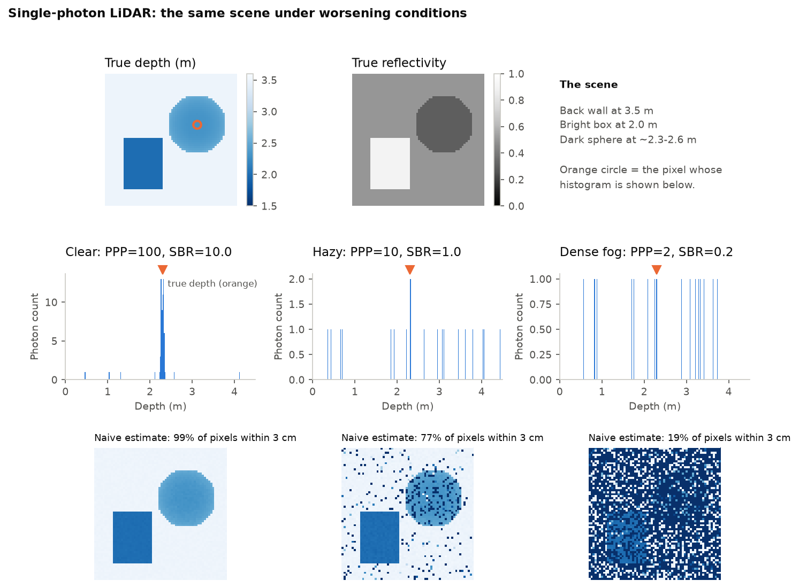
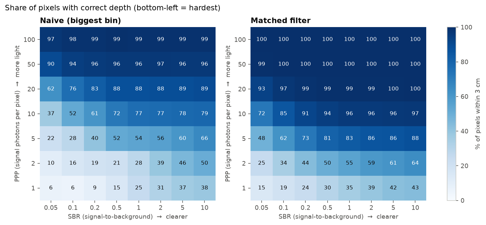
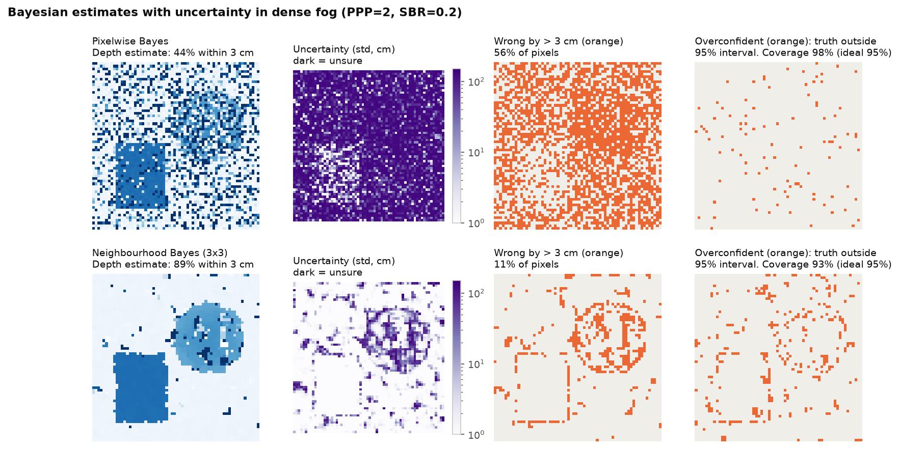
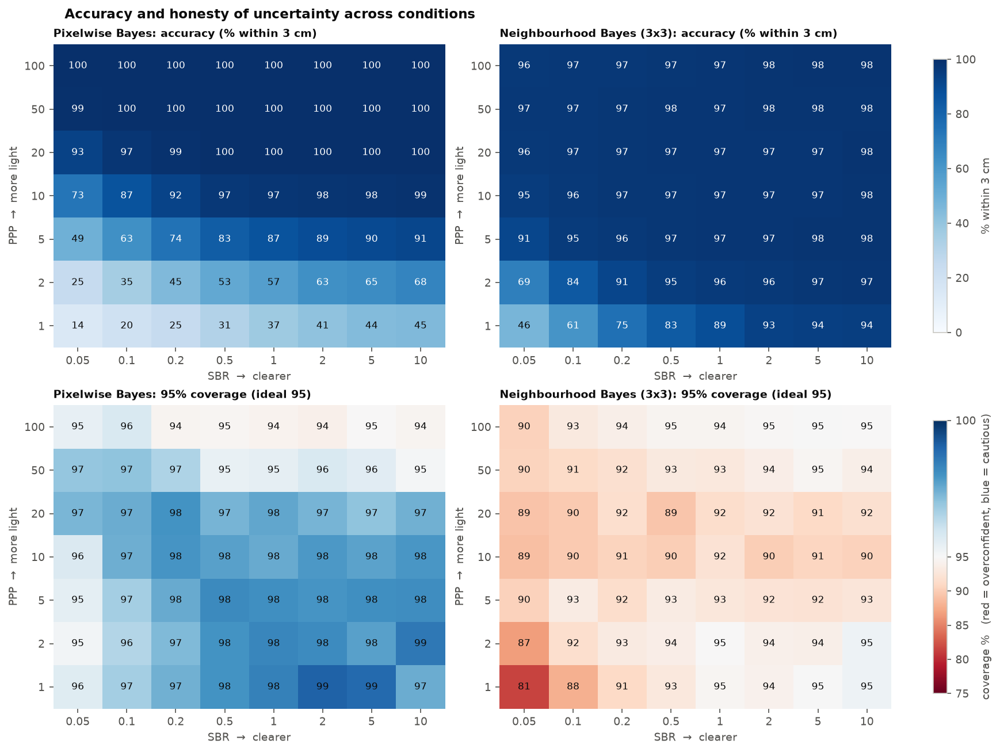
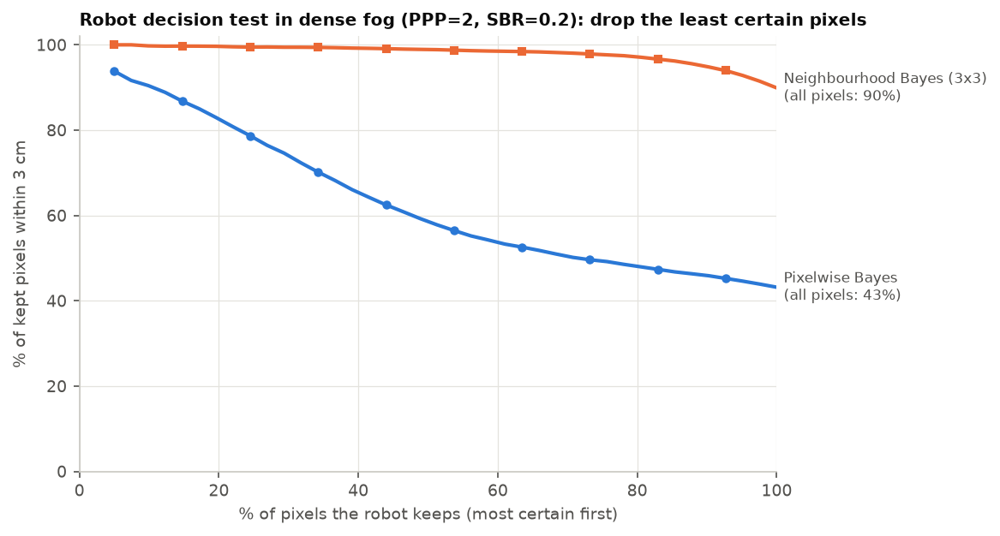
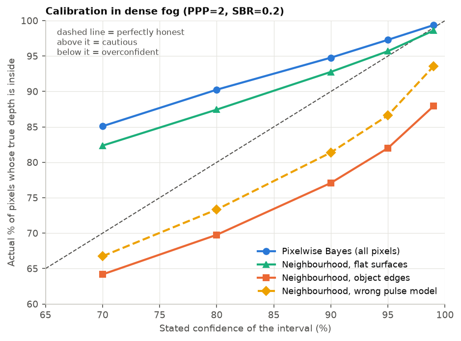

# How honest is single-photon LiDAR uncertainty when visibility degrades?

A simulation study of depth reconstruction and uncertainty quantification for
single-photon LiDAR in degraded conditions (low light, fog, turbid water).

Robots that work underwater or in smoke need 3D perception that still works when
visibility is poor, **and that knows when it cannot be trusted**. This project
simulates single-photon LiDAR data under worsening conditions, compares simple and
Bayesian depth estimators, and tests whether the Bayesian uncertainty is
*calibrated* (honest) and *useful* for a robot's decisions.

## Key findings

All results are on a simulated 64 × 64 scene, across 56 conditions
(photons per pixel × signal-to-background ratio).

| Method | Mean accuracy (% within 3 cm) | Mean 95% interval coverage |
|---|---|---|
| Naive (biggest bin) | 63% | no uncertainty |
| Matched filter | 78% | no uncertainty |
| Pixelwise Bayes | 79% | 97% (slightly cautious) |
| Neighbourhood Bayes (3 × 3) | **94%** | 92% (worst 81%) |

1. **Using neighbouring pixels is the biggest gain in accuracy.** In dense fog
   (PPP 2, SBR 0.2), it raises accuracy from 43% to 90%.
2. **The uncertainty is useful.** In dense fog, if the robot keeps only the 50% of
   pixels the neighbourhood method is most certain about, 99% of them are correct.
3. **But borrowing from neighbours makes uncertainty overconfident at object
   edges.** Its 95% intervals contain the truth for 96% of flat-surface pixels,
   but only 82% of edge pixels, where the "neighbours share my depth" assumption
   breaks.
4. **A wrong sensor model also causes overconfidence.** If the real laser pulse
   is 50% wider than the model assumes, coverage of the 95% interval drops to 87%.

Takeaway for robotics: the features that make reconstruction *accurate* in poor
visibility (spatial priors) can quietly make its uncertainty *dishonest*, exactly
where it matters most: at object boundaries. Dependable perception needs
uncertainty that is checked, not assumed.

## Figures

**1. The data.** The same scene under clear, hazy and dense-fog conditions. The
signal peak in the photon histogram disappears into the background.



**2. Baselines.** Accuracy of the naive and matched-filter estimators across all
conditions.



**3. Bayesian estimates with uncertainty in dense fog.** The right-hand column
shows where each method is overconfident. For the neighbourhood method, these
pixels trace the object edges.



**4a. Accuracy and coverage across all conditions.**



**4b. Robot decision test.** Dropping the least certain pixels removes the errors.



**4c. Calibration curves.** Where honesty breaks: object edges and a wrong pulse
model.



## Method

**Simulation (`simulator.py`).** For every pixel, the expected photon count in
time bin *t* is

    lambda_t = s · h(t − tau) + b

where *s* is the number of signal photons (scaled by surface reflectivity), *h*
the laser pulse shape (Gaussian, σ = 2 bins), *tau* the return time set by depth
(1 bin = 100 ps = 1.5 cm), and *b* the background per bin. Observed counts are
drawn from a Poisson distribution. Difficulty is controlled by **PPP** (signal
photons per pixel) and **SBR** (signal-to-background ratio).

**Estimators.**
- *Naive* (`estimators.py`): the bin with the most photons.
- *Matched filter* (`estimators.py`): cross-correlate the histogram with the
  known pulse shape and take the peak.
- *Pixelwise Bayes* (`bayes.py`): the full posterior over depth from the Poisson
  likelihood with a flat prior. Each photon "votes" for depths consistent with
  it, via a log-matched filter. Gives a MAP depth, a posterior standard
  deviation and credible intervals.
- *Neighbourhood Bayes* (`bayes.py`): the same, but each pixel also uses the
  likelihood of its 3 × 3 neighbours, assuming they share its depth.

**Evaluation (`04_calibration.py`).**
- *Accuracy*: share of pixels within 3 cm of the true depth.
- *Coverage*: share of pixels whose true depth lies inside the stated credible
  interval. For an honest 95% interval this should be about 95%.
- *Robot decision test*: accuracy of the pixels kept when the least certain
  ones are discarded first.

## How to run

```bash
pip install -r requirements.txt
python 01_simulate_data.py
python 02_baselines.py
python 03_bayesian_uncertainty.py
python 04_calibration.py        # about a minute
```

Figures are saved in `figures/`.

## Limitations

- A simple synthetic scene; no real sensor data yet.
- The background level is assumed known (in practice it is measured with the
  laser off) and the signal level is estimated crudely.
- The neighbourhood prior is a fixed 3 × 3 window, the simplest possible spatial
  model.
- A single sensor; no fusion with sonar or cameras.

## Next steps

- **Edge-aware spatial priors**, which weight neighbours by how similar they are,
  to keep the accuracy gain without the edge overconfidence.
- **Model-based deep learning** (e.g. Bayesian deep unrolling, Koo, Halimi &
  McLaughlin 2022), tested with the same calibration checks.
- **Realistic scenes** (e.g. Middlebury depth maps) and **real single-photon
  data**.
- **Uncertainty-aware fusion** with a second sensor such as sonar, so the robot
  automatically relies on whichever sensor is more trustworthy.

## References

- J. Koo, A. Halimi, S. McLaughlin, "A Bayesian Based Deep Unrolling Algorithm
  for Single-Photon Lidar Systems," *IEEE JSTSP*, 2022.
- S. Plosz, A. Maccarone, S. McLaughlin, G. S. Buller, A. Halimi, "Real-Time
  Reconstruction of 3D Videos from Single-Photon LiDaR Data in the Presence of
  Obscurants," *IEEE TCI*, 2023.
- A. Halimi, A. Maccarone, R. Lamb, G. S. Buller, S. McLaughlin, "Robust and
  Guided Bayesian Reconstruction of Single-Photon 3D Lidar Data: Application to
  Multispectral and Underwater Imaging," *IEEE TCI*, 2021.

## Author

Vibhuti Choubisa
